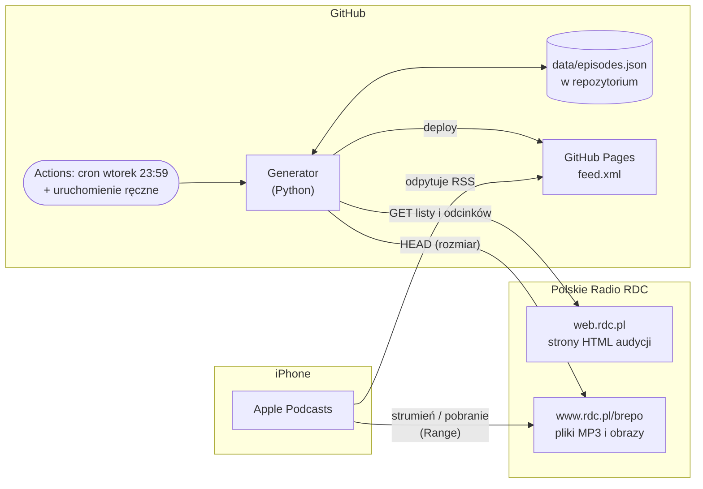
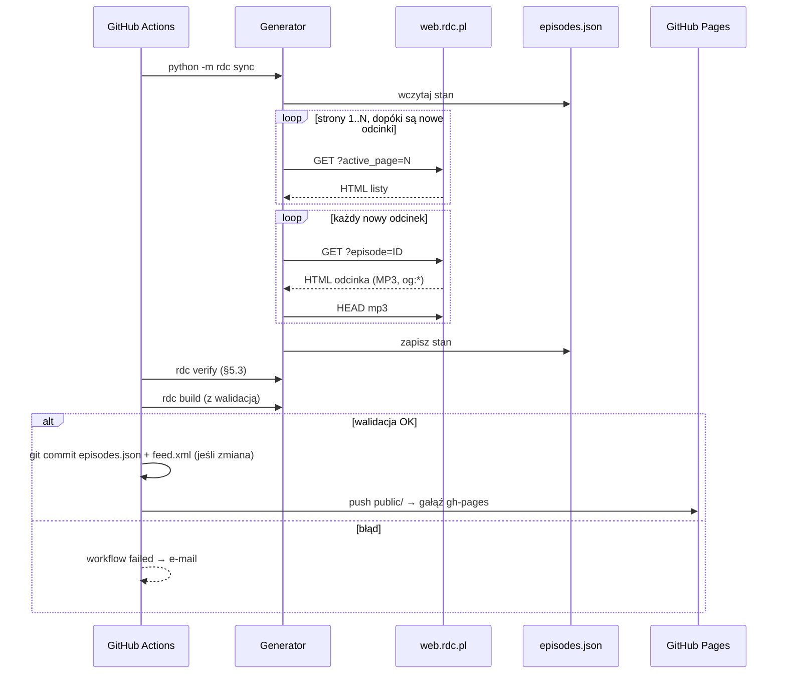

# Architektura: „Z innej planety” w Apple Podcasts

Dokumenty powiązane: [vision.md](vision.md), [requirements.md](requirements.md), [analysis.md](analysis.md)

## 1. Przegląd

System jest **statycznym generatorem kanału RSS**. Nie ma serwera aplikacyjnego, bazy danych ani interfejsu użytkownika.

- **Wykonanie:** cyklicznie w GitHub Actions.
- **Stan:** plik JSON w repozytorium.
- **Wynik:** statyczny `feed.xml` na GitHub Pages.
- **Odtwarzanie:** w całości Apple Podcasts, które pobiera MP3 bezpośrednio z serwerów RDC.



Najważniejsza cecha: **pliki audio nigdy nie przechodzą przez nasz system** (W2.9). Kanał zawiera tylko metadane i odnośniki.

## 2. Decyzje architektoniczne

| # | Decyzja | Uzasadnienie | Odrzucone alternatywy |
|---|---|---|---|
| D1 | Statyczny `feed.xml` zamiast dynamicznego endpointu | Brak serwera do utrzymania, darmowy hosting, wysoka dostępność (N1, N6) | Funkcja serverless (koszt, cold start, sekrety), własny VPS |
| D2 | GitHub Actions + Pages | Decyzja użytkownika; darmowe, wbudowane alerty e-mail (N4) | Cloudflare Workers + KV, AWS Lambda + S3 |
| D3 | Stan jako JSON w repozytorium | Wersjonowanie i historia zmian, łatwy podgląd i ręczna korekta, brak zewnętrznej bazy | SQLite (binarne diffy), cache Actions (ulotny), baza zewnętrzna |
| D4 | Python ≥ 3.12 + `httpx` + `BeautifulSoup` (`html.parser`), XML przez `xml.etree` | Dojrzałe biblioteki do HTML, prosty kod, szybki start w Actions | Node.js (cheerio), Go (więcej kodu przy parsowaniu) |
| D5 | Kanał budowany zawsze w całości ze stanu | Generacja jest deterministyczna i idempotentna, więc ponowne uruchomienie nic nie psuje | Doklejanie itemów do istniejącego XML |
| D6 | `guid` = `episodeId` z RDC | Stabilny, unikalny, niezależny od URL MP3 (W1.10, W2.4) | Hash URL MP3, URL strony |
| D7 | Deploy tylko po walidacji | Zepsuta aktualizacja zostawia poprzedni kanał (N3) | Publikacja bez kontroli |

## 3. Komponenty

```
rdc/
├── config.py       konfiguracja (adres bazowy, podcastId, limity)
├── client.py       HTTP: User-Agent, timeouty, pauzy, ponowienia
├── parser.py       HTML → modele (lista odcinków, strona odcinka, audycja)
├── models.py       Podcast, Episode (dataclasses)
├── store.py        odczyt/zapis data/episodes.json
├── sync.py         logika aktualizacji: wykrycie nowych, uzupełnienie danych
├── feed.py         modele → RSS 2.0 + iTunes (XML)
├── validate.py     sprawdzenie wygenerowanego kanału
└── __main__.py     CLI: sync | build | validate | import-archive
```

| Komponent | Odpowiedzialność | Zależy od |
|---|---|---|
| **client** | Jedyne miejsce z ruchem sieciowym. Pauza 1–2 s między zapytaniami, 3 ponowienia z backoff, wykrywanie strony Cloudflare („Just a moment”) jako osobnego błędu | config |
| **parser** | Czyste funkcje `html → model`, bez sieci. Selektory z [analysis.md §3](analysis.md#3-struktura-html) w jednym miejscu | models |
| **store** | Atomowy zapis (plik tymczasowy, potem rename), stabilna kolejność kluczy (czytelne diffy) | models |
| **sync** | Orkiestracja: pobiera strony listy, kończy przy pierwszej stronie bez nowych odcinków, dla nowych pobiera stronę odcinka i robi HEAD MP3 | client, parser, store |
| **feed** | Zawsze buduje całość ze stanu (D5). Normalizuje daty, czasy trwania, absolutne URL-e w opisach | models |
| **validate** | Reguły z §6. Kończy się kodem ≠ 0, gdy kanał jest niepoprawny | — |

Rozdzielenie **parser** (czysty) i **client** (sieć) pozwala testować parsowanie na zapisanych próbkach HTML bez dostępu do rdc.pl.

## 4. Model danych

### `data/episodes.json`
```json
{
  "podcast": {
    "id": "fY7TF0S0caRGGuoABNJe",
    "slug": "z-innej-planety",
    "title": "Z innej planety",
    "description": "…",
    "image": "https://…/cover.jpg",
    "pages_count": 159
  },
  "episodes": {
    "LVHL34Ee9ix5OGapcwGo": {
      "title": "Omawiamy: Nobel z chemii",
      "date": "2026-10-20",
      "order": 1,
      "duration_s": 3075,
      "author": "Łukasz Badowski",
      "description_html": "<p>Kenso Soai i Henri B. Kagan…</p>",
      "image": "https://www.rdc.pl/brepo/panel_repo/…_1200x630_….jpg",
      "mp3_url": "https://www.rdc.pl/brepo/panel_repo/2026/10/20/wo79bb/z-innej-planety-2010.mp3",
      "mp3_length": 69321153,
      "first_seen": "2026-10-20T18:00:00+02:00",
      "checked_at": "2026-10-24T15:00:00+02:00"
    }
  }
}
```

- Klucz słownika `episodes` to `episodeId`, czyli `guid` (D6).
- `order` to pozycja w obrębie dnia na liście RDC. Służy do wyliczenia godziny w `pubDate` (12:00 Europe/Warsaw minus `order` sekund).
- `first_seen` i `checked_at` służą do diagnostyki i okresowej weryfikacji MP3.
- Szacowany rozmiar przy ok. 1600 odcinkach to 2–4 MB, co jest akceptowalne w repozytorium.

### Artefakt: `public/feed.xml`
- RSS 2.0 z przestrzeniami nazw `itunes`, `content` i `atom`.
- Mapowanie pól według [analysis.md §4](analysis.md#4-mapowanie-na-rss).
- `<itunes:block>yes</itunes:block>`, żeby kanał nie trafił do katalogu Apple.
- `<atom:link rel="self">` wskazuje na adres Pages.

## 5. Przepływy

### 5.1 Aktualizacja (co tydzień, wtorek 23:59)


Typowy przebieg wysyła 1 zapytanie o listę i 0–2 o odcinki, co spełnia N2.

### 5.2 Import archiwum (jednorazowy)
- Uruchamiany ręcznie (`workflow_dispatch` z parametrem `pages`) lub lokalnie: `python -m rdc import-archive --from-page 1 --to-page 40`.
- Działa partiami, np. po 40 stron (ok. 440 zapytań, ok. 10 min). Po każdej partii zapisuje stan, więc przerwany import można wznowić.
- Odcinki już obecne w stanie są pomijane.

### 5.3 Weryfikacja MP3 (w ramach cotygodniowej aktualizacji)
- `rdc verify --last 20` wysyła HEAD dla 20 najnowszych odcinków.
- Gdy plik nie odpowiada, pobiera ponownie stronę odcinka i aktualizuje `mp3_url`, zachowując `guid`.
- Jeśli naprawa się nie uda, kanał i tak jest publikowany, a workflow kończy się błędem na końcu (e-mail).

## 6. Walidacja przed publikacją

Kanał nie jest publikowany (N3), jeśli zachodzi którykolwiek z warunków:
- liczba odcinków jest równa 0 albo mniejsza niż w poprzedniej wersji (ochrona przed częściowym parsowaniem);
- któryś item nie ma `guid`, `title`, `pubDate` lub `enclosure` z `url` i `length > 0`;
- `guid` się powtarzają;
- XML jest niepoprawny składniowo;
- strona listy RDC zwróciła 0 odcinków albo stronę Cloudflare. Jest to błąd, a nie „brak nowości”.

## 7. CI/CD i infrastruktura

### Repozytorium
```
.github/workflows/
├── update-feed.yml     aktualizacja kanału: cron (wtorek 23:59), ręcznie, po zmianie workflow
└── test.yml            push/PR: testy jednostkowe (Python 3.12 i 3.14)
data/episodes.json      stan (commitowany przez workflow)
public/feed.xml         kanał (commitowany; publikowany na gałęzi gh-pages)
rdc/                    kod
tests/fixtures/*.html   zapisane próbki stron RDC
docs/                   dokumentacja
```

### Harmonogram
Audycja jest emitowana we wtorki, więc kanał aktualizuje się **raz w tygodniu, we wtorek o 23:59 czasu polskiego**.

Cron w GitHub Actions działa w UTC, a Polska zmienia czas. Workflow ma więc dwa wpisy:
- `59 21 * * 2` (CEST, UTC+2),
- `59 22 * * 2` (CET, UTC+1).

Pierwszy krok sprawdza bieżące przesunięcie strefy `Europe/Warsaw` i przepuszcza tylko właściwy wpis, a drugi przebieg kończy się bez zmian. GitHub może opóźnić start zaplanowanego workflow o kilkanaście minut lub więcej.

Workflow uruchamia się też:
- ręcznie (`workflow_dispatch`, przycisk *Run workflow* w zakładce Actions),
- po każdej zmianie pliku `update-feed.yml` na `main`, co od razu sprawdza nową wersję.

### Workflow `update-feed.yml`: kroki
1. Pora uruchomienia: wybór wpisu crona zgodnego z czasem polskim.
2. `checkout` (pełna historia, potrzebna do `git subtree split`), `setup-python` 3.12 z cache, `pip install .`.
3. `rdc sync`: nowe odcinki. Blokada Cloudflare kończy workflow kodem 2 i czytelnym komunikatem.
4. `rdc verify --last 20` (§5.3), z `continue-on-error`.
5. `rdc build`: kanał z walidacją (§6). Błąd walidacji zatrzymuje workflow i nic nie jest publikowane.
6. Commit `data/episodes.json` i `public/feed.xml`, tylko gdy się zmieniły. Autor: `github-actions[bot]`.
7. Publikacja: `git subtree split --prefix public` → push na gałąź `gh-pages`. GitHub Pages (tryb *Deploy from a branch*) publikuje ją pod `https://www.sulmar.pl/rdc-z-innej-planety-rss/feed.xml`.
8. Jeśli w kroku 4 zostały niedostępne pliki MP3, workflow kończy się błędem dopiero po publikacji.
9. `concurrency: feed`, żeby dwa przebiegi nie działały równocześnie.

### Uprawnienia
- `contents: write`: commit stanu na `main` i push na `gh-pages`.
- Brak sekretów: wszystkie źródła są publiczne, a do zapisu w repozytorium wystarcza `GITHUB_TOKEN`.

### Ciągłość działania
- GitHub wyłącza harmonogram po 60 dniach bez aktywności w repozytorium.
  - Commity z nowymi odcinkami co tydzień zwykle temu zapobiegają.
  - Jeśli ostatni commit jest starszy niż 50 dni, workflow robi pusty commit „Heartbeat”.
- Nieudany przebieg: GitHub wysyła e-mail do właściciela repozytorium (N4).

## 8. Konfiguracja

| Parametr | Domyślnie | Opis |
|---|---|---|
| `RDC_BASE_URL` | `https://web.rdc.pl` | źródło HTML (N5) |
| `RDC_MEDIA_BASE_URL` | `https://www.rdc.pl` | host w `enclosure` i obrazkach |
| `PODCAST_PATH` | `z-innej-planety_fY7TF0S0caRGGuoABNJe` | audycja; w przyszłości lista |
| `REQUEST_DELAY_S` | `1.5` | pauza między zapytaniami |
| `MAX_PAGES_INCREMENTAL` | `3` | limit stron w trybie przyrostowym |
| `FEED_MAX_ITEMS` | brak | opcjonalne obcięcie archiwum w kanale |
| `FEED_URL` | `https://{user}.github.io/{repo}/feed.xml` | `atom:link self` |

Zmienne ustawia się jako `vars` repozytorium w GitHub, bez zmian w kodzie.

## 9. Obsługa błędów i obserwowalność

| Sytuacja | Zachowanie |
|---|---|
| Timeout lub 5xx z RDC | 3 ponowienia z backoff, potem błąd workflow |
| Strona Cloudflare / 403 | Natychmiastowy błąd z komunikatem „źródło zablokowane” |
| Brak `source[src]` na stronie odcinka | Odcinek pomijany w tym przebiegu (log ostrzeżenia), ponowna próba przy następnym. Jeśli dotyczy wszystkich nowych odcinków, workflow kończy się błędem |
| Walidacja nieudana | Brak deployu, błąd workflow |
| Błąd workflow | E-mail od GitHub (N4); szczegóły w logach Actions |

Logi to zwykły tekst w Actions: liczba pobranych stron, nowe odcinki (ID + tytuł), czas trwania przebiegu.

## 10. Testowanie

- **Jednostkowe (parser):** zapisane próbki HTML z `tests/fixtures` pokrywają stronę listy, stronę odcinka, element „Teraz odtwarzane” bez linku i stronę Cloudflare.
- **Jednostkowe (feed):** deterministyczny XML dla zadanego stanu (snapshot), konwersje czasu i dat.
- **Walidacja zewnętrzna:** ręcznie po pierwszym wdrożeniu, przez Podcasts Connect / castfeedvalidator.
- **Akceptacja:** scenariusze z [requirements.md](requirements.md), sprawdzane ręcznie na iPhonie.

## 11. Rozszerzalność

- **Inne audycje RDC:** `PODCAST_PATH` → lista, stan `data/{podcastId}.json`, kanał `public/{slug}.xml`. Parser się nie zmienia, bo wszystkie audycje mają ten sam szablon.
- **Plan B przy blokadzie Cloudflare:** dodatkowa implementacja `client` oparta na Playwright (przeglądarka headless w Actions) za tym samym interfejsem. Pozostałe komponenty bez zmian.
- **Inne aplikacje podcastowe** (Overcast, Pocket Casts) działają od razu, bo kanał jest standardowym RSS.
